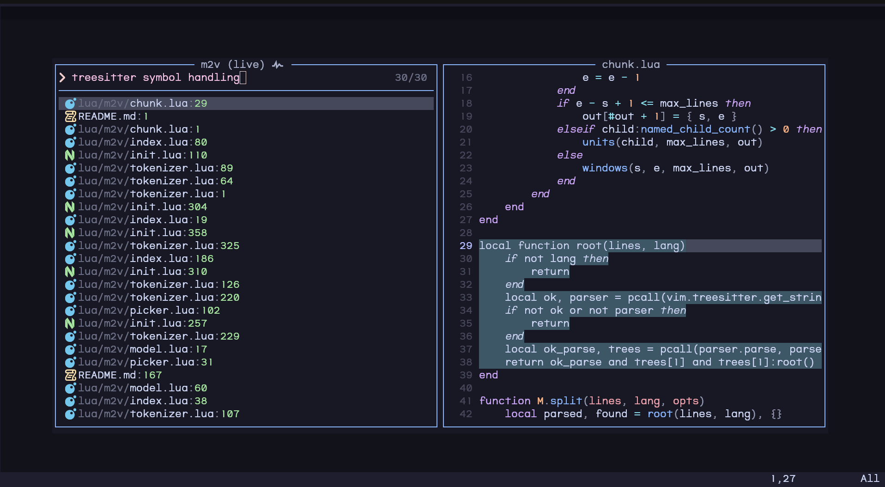
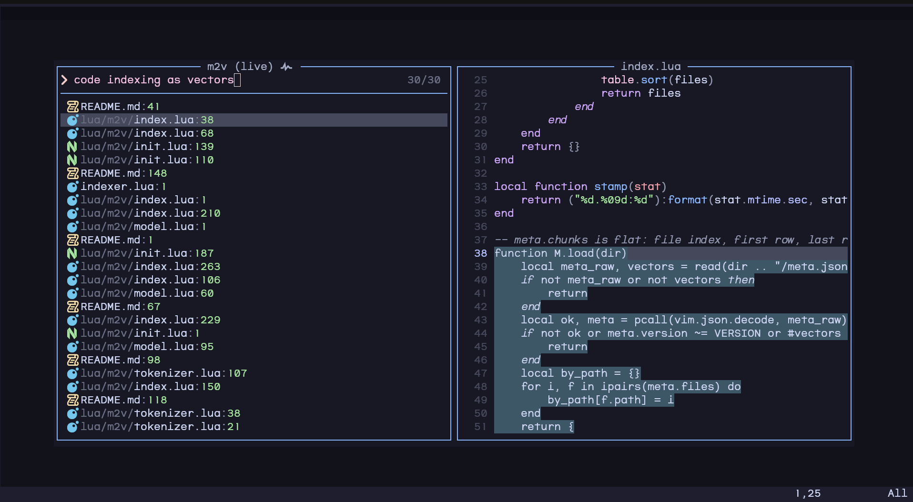

# m2v.nvim

Semantic code search for Neovim, built on [model2vec](https://github.com/MinishLab/model2vec) static embeddings. Runs entirely inside the editor through LuaJIT FFI, treesitter and the utf8proc bundled with nvim. No Python, no server.

Queries are matched by meaning and fused with `rg` lexical matches, so "code indexing as vectors" finds `index.lua` even when none of those words appear in it.




## Features

- Pure Lua model2vec inference: WordPiece and Unigram tokenizers, mmap'd safetensors (F16/F32)
- Treesitter-aware chunking, with line windows as fallback
- Background, incremental indexing per project root, parallelised across worker processes
- Hybrid ranking: cosine similarity fused with `rg` matches (reciprocal rank fusion)
- "Find similar": chunks that resemble the selection or the code under the cursor
- ~30 ms queries on a 10k-chunk index
- [snacks.nvim](https://github.com/folke/snacks.nvim) pickers or the quickfix list, plain Lua API, `:checkhealth m2v`

## Requirements

- Neovim built with LuaJIT (tested on 0.12.6)
- `rg` for file listing and lexical ranking (`git ls-files` is the listing fallback)
- `curl` for the one-time model download
- snacks.nvim for the pickers (optional: without it results go to the quickfix list)

## Install

[lazy.nvim](https://github.com/folke/lazy.nvim):

```lua
{
    "FoamScience/m2v.nvim",
    main = "m2v",
    opts = {},
    keys = {
        { "<leader>fS", function() require("m2v.picker").search_prompt() end, desc = "Semantic search" },
        { "<leader>fL", function() require("m2v.picker").live() end, desc = "Semantic search (live)" },
        { "<leader>fs", function() require("m2v.picker").similar() end, mode = { "n", "x" }, desc = "Similar code" },
    },
}
```

Only directories with a root marker (`.git` by default) are indexed. Indexes live in `stdpath("cache")/m2v/index/`, are built in the background on first search and refreshed after writes. The live picker starts searching once the query has 3 words (`picker.min_live_words`).

Picker queries accept scope tokens, which do not count as words:

| token | effect |
|---|---|
| `path:GLOB` | only files matching GLOB (repeatable) |
| `-path:GLOB` | skip files matching GLOB |
| `-lex` | semantic ranking only, no `rg` half |

Globs follow `rg -g` / gitignore rules: `*.lua` matches the file name at any depth, `lua/**` is anchored at the root. Example: `parse diff hunks path:lua/** -path:tests/** -lex`.

## Find similar

`require("m2v.picker").similar()` embeds the visual selection, or the indexed chunk under the cursor, and lists the closest chunks by cosine (semantic half only, no `rg`). The source chunk itself is left out; `roots` and `paths` options work as for search.

It surfaces copy-pasted and parallel code across modules. Measured on mini.nvim (342 sampled chunks from `lua/mini/*.lua`): 64.7% of the top 5 hits belong to the same module (its source, doc, readme or tests) against 1.9% by chance, 21.9% in another file of that module. On snacks.nvim (188 samples): 58.9% against 16.6%. Examples from mini.nvim: `H.span_distance` in `ai.lua` finds its copy in `surround.lua` at 0.996; `H.is_region_array` finds `H.is_region_pair_array` (0.79) and two `H.is_array_of` copies (0.73, 0.71).

## Configuration

Defaults:

```lua
opts = {
    model = "minishlab/potion-code-16M-v2",
    max_tokens = 512,
    max_file_bytes = 256 * 1024,
    chunk = { max_lines = 60, target_lines = 30 },
    root_markers = { ".git" },
    rrf_k = 60, -- reciprocal rank fusion constant
    depth = 100, -- candidates taken from each ranking before fusion
    min_similarity = 0, -- semantic candidates below this cosine to the query are dropped
    lexical = { max_terms = 16, min_len = 3, max_count = 20 },
    rebuild_delay_ms = 2000,
    cache_size = 32, -- searches remembered per root, dropped on writes, reindex and after cache_ttl_ms; 0 disables
    cache_ttl_ms = 60000,
    workers = math.min(4, #vim.uv.cpu_info()), -- indexer processes for a full index; 1 = single process
    picker = {
        n = 30,
        ui = "auto", -- "auto": snacks.nvim when installed; "quickfix": always the quickfix list
        roots = {}, -- other project roots searched alongside the current one, e.g. { "~/.config/nvim" }
        min_live_words = 3,
        test_patterns = { ... }, -- hidden unless the query mentions test or spec
    },
}
```

Pickers show each semantic hit's cosine to the query next to the file name. Cosines are not calibrated across queries or corpora: on mini.nvim, the best chunk for "banana smoothie recipe" scores 0.22 while relevant top hits for real queries score 0.4-0.7, and on a small repo relevant top hits can sit below 0.3. Pick `min_similarity` per corpus, or leave it at 0.

### Parallel indexing

With `workers > 1` the indexer runs as a coordinator: it lists files, reuses unchanged chunks from the previous index, shards the rest by size across up to `workers` child `nvim -l` processes, and merges their output in file order. Each worker loads the model (about 300 MB peak RSS for potion-code-16M-v2). Fewer than 32 changed files per worker reduces the worker count, so a rebuild after a few saves embeds in the coordinator alone. `vectors.bin` is byte-identical for any worker count.

## API

```lua
local m2v = require("m2v")
local root = m2v.root(vim.api.nvim_get_current_buf()) -- nil outside a project
-- hits: { root, path, start, end, score, similarity? }, 1-based inclusive lines, best first
-- similarity: cosine to the query, set on chunks the semantic half ranked
local job = m2v.search(root, "parse json responses", 10, function(hits) end)
-- scoped: same globs as the picker tokens; lexical = false drops the rg half
m2v.search(root, "parse json responses", 10, function(hits) end, { paths = { "lua/**", "!tests/**" }, lexical = false })
-- chunks resembling a piece of text; skip drops hits overlapping its own range
m2v.similar(root, text, 10, function(hits) end, { skip = { path = path, start = 10, ["end"] = 40 } })
-- 1-based range of the indexed chunk holding a row
local s, e = m2v.chunk_at(root, path, row)
-- several roots: hits merged by fused score, each hit carries its root
m2v.search({ root, vim.fn.expand("~/.config/nvim") }, "parse json responses", 10, function(hits) end)
-- job:kill() cancels the ripgrep half
```

The pickers take the same option per call: `require("m2v.picker").live({ roots = { "~/notes" } })`. Extra roots need no root marker; they are indexed on their first search.

## Models

Set `opts.model`. Models are taken from `~/.cache/huggingface/hub` when present, otherwise downloaded to `stdpath("cache")/m2v/models/`. Each model gets its own index.

Supported: WordPiece and Unigram (Metaspace, `split = false`) tokenizers; an `embeddings` tensor (F16 or F32), optionally with the `mapping` (I64) and `weights` (F64) tensors added by model2vec vocabulary quantization.

| model | dim | tokenizer | tensors |
|---|---|---|---|
| potion-base-2M | 64 | WordPiece | `embeddings` F32 |
| potion-base-4M | 128 | WordPiece | `embeddings` F32 |
| potion-base-8M | 256 | WordPiece | `embeddings` F32 |
| potion-base-32M | 512 | WordPiece | `embeddings` F32 |
| potion-retrieval-32M | 512 | WordPiece | `embeddings` F32 |
| **potion-code-16M-v2** (default) | 256 | WordPiece | `embeddings` F16 |
| potion-code-16M | 256 | WordPiece | `embeddings` F32 + `mapping` I64 + `weights` F64 |
| potion-multilingual-128M | 256 | Unigram | `embeddings` F32 (500353 × 256, 512 MB) |

All listed models are tested and work.

## Layout

| file | role |
|---|---|
| `lua/m2v/tokenizer.lua` | BERT WordPiece (BertNormalizer + BertPreTokenizer); Unigram (sentencepiece precompiled charsmap + Metaspace + Viterbi) |
| `lua/m2v/model.lua` | safetensors loader (mmap), mean pooling with model2vec mapping/weights, L2 normalization |
| `lua/m2v/chunk.lua` | treesitter chunking: top-level nodes, split when too big, small neighbours merged |
| `lua/m2v/index.lua`, `indexer.lua` | per-root index built by a background `nvim -l`, incremental by mtime/size, sharded across workers |
| `lua/m2v/init.lua` | model lookup/download; brute-force cosine search fused with `rg` |
| `lua/m2v/picker.lua` | snacks.nvim pickers, quickfix fallback (`live()` then prompts for one query) |
| `lua/m2v/health.lua` | `:checkhealth m2v` |

## Benchmarks

Intel i5-11600KF (12 threads), 45 GB RAM, NVIM v0.12.6 (LuaJIT 2.1), measured 2026-10-30 from headless `nvim -l` with models on disk. Corpus: mini.nvim @ a03ad89, 3106 files, 10416 chunks.

### End to end

Fresh index, `workers = 4`. "Ready" is first `search()` until the index exists (±0.5 s between runs). Queries are full `search()` calls (rg + semantic + fusion); q1 includes loading the model.

| model | ready | vectors.bin | q1 | q2 | q3 |
|---|---|---|---|---|---|
| potion-base-2M | 0.8 s | 2.7 MB | 34 ms | 37 ms | 20 ms |
| potion-base-4M | 1.5 s | 5.3 MB | 33 ms | 33 ms | 20 ms |
| potion-base-8M | 2.0 s | 10.7 MB | 31 ms | 28 ms | 31 ms |
| potion-base-32M | 1.3 s | 21.3 MB | 41 ms | 30 ms | 24 ms |
| potion-retrieval-32M | 1.5 s | 21.3 MB | 41 ms | 29 ms | 23 ms |
| **potion-code-16M-v2** | 1.1 s | 10.7 MB | 38 ms | 28 ms | 31 ms |
| potion-code-16M | 1.1 s | 10.7 MB | 37 ms | 29 ms | 29 ms |
| potion-multilingual-128M | 2.1 s | 10.7 MB | 331 ms | 32 ms | 25 ms |

q1 = "highlight word under cursor", q2 = "parse git diff hunks", q3 = "fuzzy match score". Every WordPiece model returned the same top-3 files (`cursorword`, `diff`, `fuzzy` sources, docs and tests). potion-multilingual-128M differs on q2. On this corpus the rg side of the fusion carries a lot of weight, so these queries separate models little.

### vs [sgrep](https://github.com/context-dot-dev/sgrep) 0.3.0

Same corpus and queries, top 5, potion-code-16M-v2, timed from the shell.

| | sgrep | m2v |
|---|---|---|
| full index | 1.0 s (12 threads), 571 MB peak RSS | 1.2 s (`workers = 4`), 459 MB summed; 3.6 s / 233 MB single process |
| query, cached index | 70-80 ms (CLI start + model load + search) | 20-40 ms inside the editor |

Results overlap heavily; sgrep ranks `lua/mini/git.lua` first for q2.

<details>
<summary>Parallel indexing</summary>

Full index via `nvim -l indexer.lua`, summed RSS of the process tree sampled every 50 ms. The model is mmap'd read-only, so shared page-cache pages are counted once per process.

| model, workers | full index | peak RSS (all processes) |
|---|---|---|
| potion-code-16M-v2, 1 | 3.6 s | 233 MB |
| potion-code-16M-v2, 2 | 2.1 s | 326 MB |
| potion-code-16M-v2, 3 | 1.4 s | 394 MB |
| potion-code-16M-v2, 4 (default) | 1.2 s | 459 MB |
| potion-code-16M-v2, 6 | 1.2 s | 490 MB |
| potion-code-16M-v2, 8 | 0.9 s | 651 MB |
| potion-code-16M-v2, 12 | 1.0 s | 783 MB |
| potion-multilingual-128M, 1 | 5.6 s | 812 MB |
| potion-multilingual-128M, 2 | 3.4 s | 1501 MB |
| potion-multilingual-128M, 4 | 2.4 s | 2761 MB |

Incremental rebuilds, `workers = 4`: nothing changed 0.1 s / 78 MB; 1 file 0.2 s / 80 MB; 50 files 0.6 s / 277 MB (2 workers).

</details>

<details>
<summary>Components</summary>

| measurement | result |
|---|---|
| model load, potion-code-16M-v2 (32 MB F16) | 12 ms |
| model load, potion-multilingual-128M (500k-piece vocab, 512 MB F32) | 297 ms |
| 500 embeds of a ~400-token chunk | 70 ms (code-16M-v2), 104 ms (base-32M), 135 ms (multilingual-128M) |
| brute-force cosine scan, 10419 × 256 | 5.4 ms |
| tokenizer throughput, mini.nvim line by line (11.3 MB) | WordPiece 5.5 MB/s, Unigram 2.7 MB/s |
| full index, nvim config (96 files, 448 chunks) | 1.3 s |
| incremental re-index, nothing changed (96 files) | 0.26 s |

</details>

<details>
<summary>Correctness</summary>

Token ids match HF `tokenizers` 0.23.3 (`[UNK]` dropped, as model2vec does):

- WordPiece (potion-code-16M-v2): 6 samples covering Lua, Python with accents, C++, SQL, odd whitespace and prose. Identical.
- Unigram (potion-multilingual-128M): 21 samples covering German, Russian, Japanese, Arabic, Greek, Hindi, Vietnamese, ZWJ emoji, combining marks, NFKC cases (`fi ① ™ ½`), odd whitespace and literal `[UNK]`. Identical. Over 3077 mini.nvim lines, 47 differ only in the order of equal-score segmentations (runs like `────`, `8888`); token multisets, and so embeddings, are identical. HF runs Viterbi over the whole sentence, m2v per `▁word`, so float rounding breaks ties differently.

Embeddings vs `model2vec.StaticModel.encode` 0.10.0, cosine between normalized vectors:

| model | samples | min cos | max cos |
|---|---|---|---|
| potion-base-2M / 4M / 8M / 32M, potion-retrieval-32M | 6 lines | 1.000000 | 1.000000 |
| potion-code-16M-v2 | 6 lines | 0.999952 | 1.000001 (F16 rounding) |
| potion-code-16M | 6 lines | 1.000000 | 1.000000 |
| potion-multilingual-128M | 19 multilingual + 400 mini.nvim lines | 1.000000 | 1.000000 |

</details>
